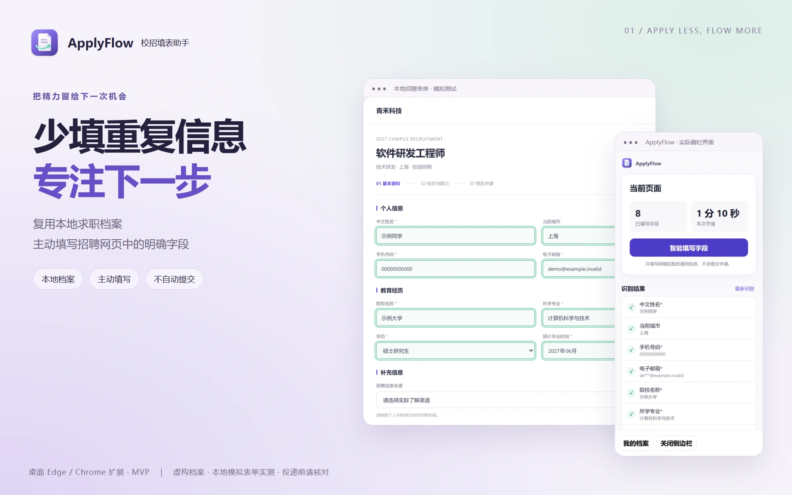

# ApplyFlow · 造物集产品素材（main 版本依据修正版）

本版替代旧素材提交 939c024 的截图依据。旧版使用未提交的 0.8.7 开发代码，不能证明 main 界面；本次已全部按固定 main 提交重新运行并拍摄，没有提交或覆盖原工作区 0.8.7 业务改动。

## 可复现版本

- 产品代码提交：[594946947787a072082f193b0549b9942b05cba3](https://github.com/liaoyiming222-art/applyflow-campus-autofill/tree/594946947787a072082f193b0549b9942b05cba3)
- manifest 版本：0.7.8；该提交是本次核对时的远端 main。它证明已提交源码的界面，不代表商店上架或正式安装验收。
- 原始截图、运行证据与文件校验：[captures](captures/) · [run-result.json](source/run-result.json) · [ui-version.json](source/ui-version.json)
- 每张图的尺寸、格式、SHA-256、中文 alt、用途和来源：[manifest.json](manifest.json)

## 复现命令

检出包含本素材的固定提交，在其项目根安装 package-lock 对应依赖和 Microsoft Edge，然后运行：

```sh
node docs/portfolio-assets/source/capture.mjs
node docs/portfolio-assets/source/render.mjs
node docs/portfolio-assets/source/verify.mjs
```

capture.mjs 在采集前逐文件校验运行源码与上述固定 Git 提交，不一致就拒绝采集。Windows 检出的 CRLF 会先归一为 LF 比较；记录的 SHA-256 是 Git blob 原始字节。无需原作者未提交工作区、真实档案或登录账号。若从更新分支复现，请另建固定版本隔离检出，不覆盖自己的修改。

采集使用该 main 已提交的 tools/brand-preview.mjs 和 docs/brand/desk 受控演示。招聘网页为本地模拟，浏览器 API 为内存桥；识别、填写、侧栏及档案编辑器使用原产品代码，不返回预设填写数、不重画 UI。姓名为示例同学，号码为无效占位符，邮箱使用 .invalid，学校为示例大学。原始截图在 captures/，四份 source/*.html 为独立构图排版源。正式 SVG 图标沿用同一 main 提交。生成器依赖本地文件和系统字体，无热链、无付费生成服务。

## 功能边界

本轮实际填写 8 项，招聘来源保持空白，申请按钮不可提交。时间为原产品算法估算，不是实测效率；累计值仅来自本轮临时内存。没有自动提交、真实网站兼容或扩展安装的验收。档案图仅展示 main 的编辑器，不展示 0.8.7 新增导出控件，也不承诺本轮验证了简历解析。产品不接 AI；MVP，桌面 Edge 优先并尽量兼容 Chrome，不支持手机安装。

## 交付与检查

icon.svg 为256×256矢量画布，icon-512.png 为512×512。hero.webp 为1920×1200，card.webp 为1200×900，mobile.webp 为900×1200，detail-01.webp 为1920×1200。四张分别构图，详情展示本地档案维护。已核对桌面/窄屏缩略展示及32/40px图标，见 source/qa-preview.png。没有修改业务、部署或账号权限，未修改造物集仓库。


